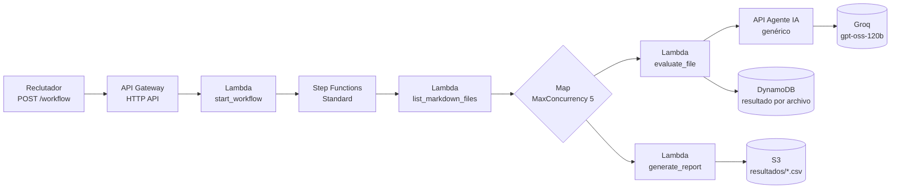

# Evaluador de pruebas técnicas de SQL con IA sobre AWS Serverless

Corrector automático de pruebas técnicas de SQL. El postulante escribe sus respuestas en un
archivo de texto y lo envía por correo; un agente de IA lo corrige contra una rúbrica fija y
devuelve un CSV comparativo con el puntaje y la retroalimentación de cada candidato.

Todo el criterio de evaluación vive en **un archivo markdown en S3**, no en el código. Cambiar
ese archivo cambia lo que el sistema evalúa, sin desplegar nada.

---

## El problema

Una empresa toma la misma prueba de SQL a todos los postulantes al puesto de Analista de
Datos. Son tres preguntas que el candidato resuelve **en vivo**, escribiendo las sentencias
sin ejecutarlas contra una base de datos. Cada uno escribe sus respuestas en un archivo del
bloc de notas y lo manda por correo.

El reclutador termina con decenas de archivos de texto sin formato, en minúsculas y sin
sangría, y tiene que corregirlos todos con el mismo criterio. Es trabajo repetitivo donde el
cansancio hace que el candidato número 30 no reciba la misma lectura que el número 1.

## La solución

| Pregunta | Técnica evaluada | Puntos |
|---|---|---|
| 1 | `LEFT JOIN` con agregación y manejo de nulos | 30 |
| 2 | `CTE` + `GROUP BY` + `HAVING` | 30 |
| 3 | Procedimiento almacenado con parámetro de entrada | 30 |
| — | Estilo y claridad | 10 |

Las dos tablas de la prueba (`empleados` y `ventas`, 10 filas cada una) están escritas dentro
del propio archivo de instrucciones, junto con las respuestas de referencia y los valores
exactos que debe devolver cada consulta. El agente no necesita conectarse a ninguna base de
datos para saber si la respuesta es correcta.

### Los datos tienen trampas a propósito

No son diez filas al azar. Están construidas para que cada técnica importe de verdad:

- **Los empleados 6, 8 y 9 no registran ninguna venta.** Quien use `INNER JOIN` en la pregunta
  1 pierde esas tres filas y ni siquiera se da cuenta: la consulta corre sin error y devuelve
  resultados que parecen correctos.
- **El departamento Soporte queda en 0.** El `HAVING > 3000` de la pregunta 2 tiene que
  dejarlo fuera, así que filtrar con `WHERE` no solo es un error conceptual: tampoco ejecuta.
- **La pregunta 3 pide un parámetro de entrada.** El atajo típico es escribir el departamento
  fijo en el `WHERE`, que devuelve el resultado esperado para un caso y falla para el resto.

Es la diferencia entre evaluar si el SQL corre y evaluar si el candidato entendió la técnica.

---

## Arquitectura



El workflow recibe dos rutas de S3: el archivo de instrucciones y la carpeta con los archivos
a evaluar. Lista la carpeta, procesa cada archivo en paralelo contra el mismo agente, guarda
cada resultado en DynamoDB y consolida todo en un CSV comparativo.

**La pieza que hace que esto sea reutilizable:** el agente de IA es genérico. Recibe un archivo
de instrucciones y un archivo de contenido, y devuelve lo que las instrucciones le pidan. Este
mismo despliegue corrige pruebas de SQL y, cambiando solo la carpeta de S3, evalúa currículums
para un perfil de Data Engineer. No se tocó una línea de código entre un caso y el otro.

---

## Decisiones de diseño

### El JSON de salida define las columnas del CSV

El paso `generate_report` arma el CSV tomando las **claves de primer nivel** del JSON que
devuelve el agente. Eso impone un contrato estricto sobre las instrucciones:

```json
{"nombre_candidato":"","pt_p1_left_join":0,"pt_p2_cte_having":0,"pt_p3_procedimiento":0,
 "pt_estilo":0,"puntaje_total":0,"nivel":"","resultado":"","p1_estado":"","p2_estado":"",
 "p3_estado":"","error_principal":"","comentario_p1":"","comentario_p2":"","comentario_p3":"",
 "recomendacion":""}
```

- **JSON plano, sin anidar.** Un objeto anidado se convertiría en una sola columna ilegible.
- **Claves fijas, en minúsculas y sin tildes.** Si el modelo improvisa una clave, aparece una
  columna nueva y el CSV deja de ser comparable entre candidatos.
- **Prohibido el punto y coma dentro de los valores,** porque es el delimitador del CSV. Mismo
  motivo para las comillas dobles y los saltos de línea.

### El tope del 40 %

> Si no usa la técnica pedida, esa pregunta no pasa del 40 % de su puntaje aunque el resultado
> se parezca al esperado.

Sin esta regla un modelo generoso aprueba a cualquiera que devuelva los números correctos por
el camino equivocado, que es justo lo que la prueba quiere detectar. En la ejecución real la
regla se aplicó sola: la tercera candidata resolvió la pregunta 1 con una subconsulta en vez
de `LEFT JOIN` y obtuvo **12 de 30**, que es exactamente el tope.

### Un comentario por pregunta, no solo una nota

Cada fila del CSV trae `comentario_p1`, `comentario_p2` y `comentario_p3` dirigidos al
candidato. El archivo sirve como devolución, no únicamente como ranking.

---

## Resultados de la ejecución real

Tres candidatos ficticios de distinto nivel, generados a propósito para validar que la rúbrica
discrimina. El CSV completo está en
[`resultados/resultado-ejecucion.csv`](resultados/resultado-ejecucion.csv).

| Candidato | P1 | P2 | P3 | Estilo | Total | Resultado |
|---|---|---|---|---|---|---|
| Ana Flores Quiroz | 30 | 30 | 30 | 9 | **99** | Aprobado - pasa a entrevista |
| Bruno Cáceres Delgado | 10 | 30 | 6 | 7 | **53** | Observado - requiere segunda prueba |
| Carla Ibáñez Soto | 12 | 8 | 6 | 6 | **32** | No aprueba |

En los tres casos el total es la suma exacta de los cuatro criterios, así que la nota se puede
verificar a mano.

Lo más interesante del resultado: las instrucciones solo decían que filtrar un agregado con
`WHERE` es un error conceptual. El modelo, por su cuenta, dedujo y escribió la consecuencia
real — *"la consulta ni siquiera se ejecuta"*.

---

## Un problema que apareció en la ejecución

La primera corrida falló. Step Functions reportó un `RuntimeError` en el paso
`EvaluateOneFile` con un **HTTP 429** de Groq:

```
Rate limit reached ... tokens per minute (TPM): Limit 8000, Used 5471, Requested 2756
```

**La causa.** El estado `Map` procesa los archivos en paralelo, y el archivo de instrucciones
viaja **completo con cada uno**. Con tres candidatos eran 3 × 2 756 ≈ 8 268 tokens: 268 por
encima del límite de la capa gratuita. El costo del prompt se multiplica por el número de
archivos, no por el tamaño del lote.

**La solución.** Reescribir el archivo de instrucciones de 6,4 KB a 4,5 KB reemplazando las
tablas de markdown por listas separadas por comas, sin quitar ni una regla ni un dato. El
consumo bajó a unos 5 750 tokens y la segunda ejecución terminó correctamente.

No se cambió nada de la infraestructura. Las alternativas eran bajar `MaxConcurrency` a 1,
que serializa el lote y lo vuelve lento, o pagar un tier superior. Comprimir el prompt
resolvió el problema sin ninguna de las dos concesiones.

---

## Contenido del repositorio

| Ruta | Qué es |
|---|---|
| [`s3/instrucciones-prueba-tecnica-sql.md`](s3/instrucciones-prueba-tecnica-sql.md) | El cerebro del sistema: enunciado, tablas, respuestas de referencia, rúbrica y contrato JSON |
| [`s3/contenido/`](s3/contenido/) | Las respuestas de los tres candidatos, como texto plano de bloc de notas |
| [`resultados/`](resultados/) | El CSV comparativo que generó el workflow |
| [`postman/`](postman/) | Colección para disparar el workflow |
| [`docs/`](docs/) | Página del caso y los prompts con los que se generaron los archivos |

---

## Cómo reproducirlo

Necesitas el workflow serverless desplegado (API Gateway + Step Functions + Lambda + DynamoDB
+ S3) y una API key de Groq.

**1.** Subir a S3 el archivo de instrucciones en `ej2/` y la carpeta `contenido/` dentro:

```
s3://TU-BUCKET/ej2/instrucciones-prueba-tecnica-sql.md
s3://TU-BUCKET/ej2/contenido/respuestas-01-ana-flores.md
s3://TU-BUCKET/ej2/contenido/respuestas-02-bruno-caceres.md
s3://TU-BUCKET/ej2/contenido/respuestas-03-carla-ibanez.md
```

> Las instrucciones van **fuera** de `contenido/`. El paso `list_markdown_files` lista todos
> los `.md` del prefijo, así que un archivo de instrucciones dentro de esa carpeta se
> evaluaría como si fuera un candidato más.

**2.** Importar [`postman/coleccion.json`](postman/coleccion.json), reemplazar las variables
`bucket`, `urlAgente` y `urlWorkflow` por las de tu despliegue y lanzar la petición 2.

**3.** Esperado: `HTTP 202`, un `Map` con tres iteraciones en Step Functions, tres elementos en
DynamoDB y un CSV nuevo en `resultados/`.

El CSV usa punto y coma como delimitador y `utf-8-sig`, para que Excel en español lo abra en
columnas sin pasar por el asistente de importación.

---

## Stack

`AWS Lambda` · `Step Functions` · `API Gateway` · `DynamoDB` · `S3` · `Serverless Framework`
· `Python 3.14` · `Groq (openai/gpt-oss-120b)`

---

## Nota

Proyecto académico desarrollado para el curso de Cloud Computing de la Maestría en Ciencia de
Datos (UTEC). Los nombres de los candidatos y sus respuestas son ficticios, generados para
validar la rúbrica. El repositorio no incluye el código del workflow, que es material del
curso, ni credenciales de ningún tipo.
